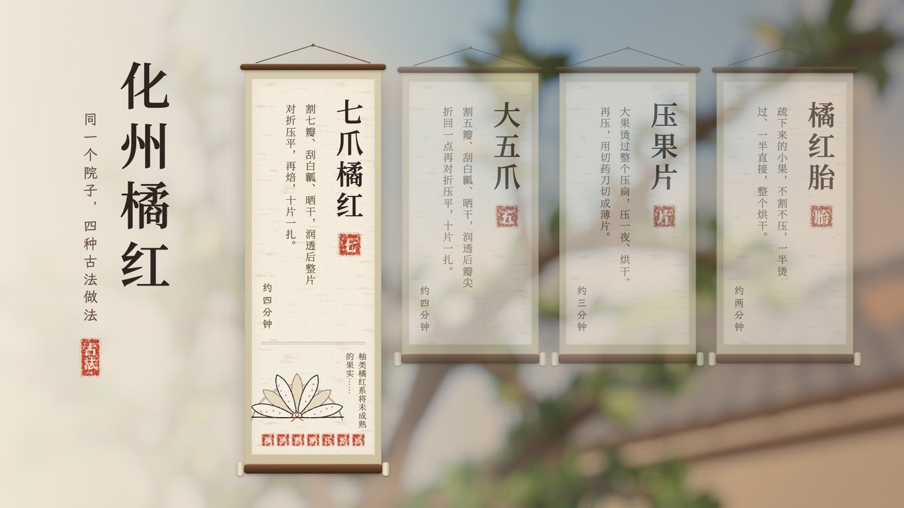
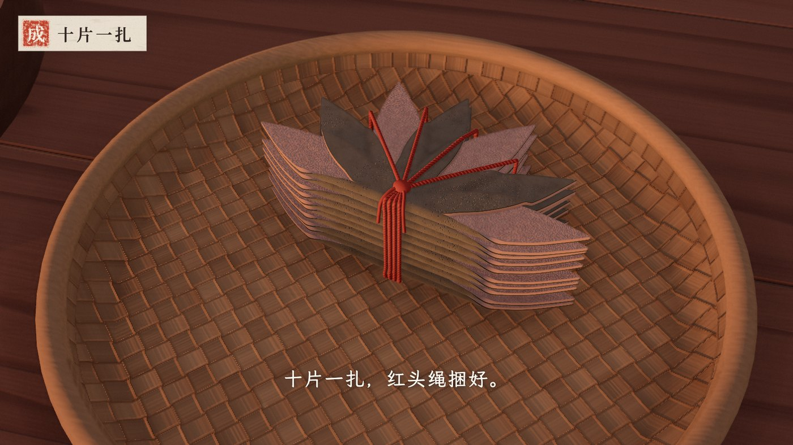
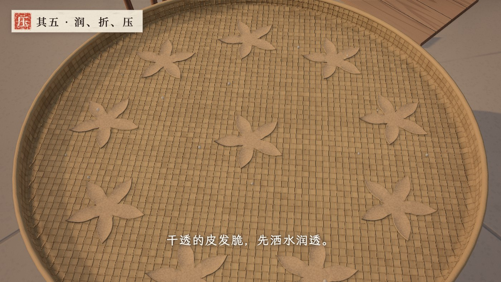
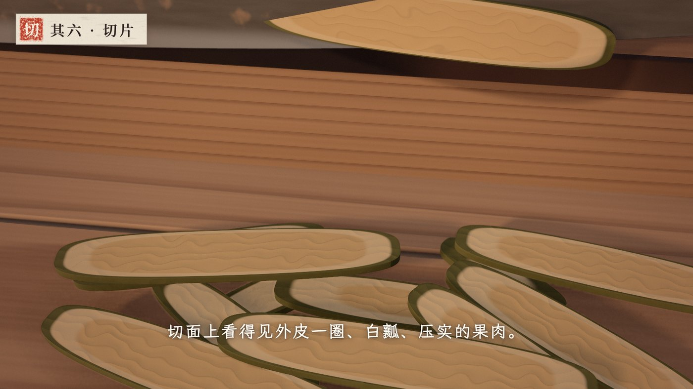
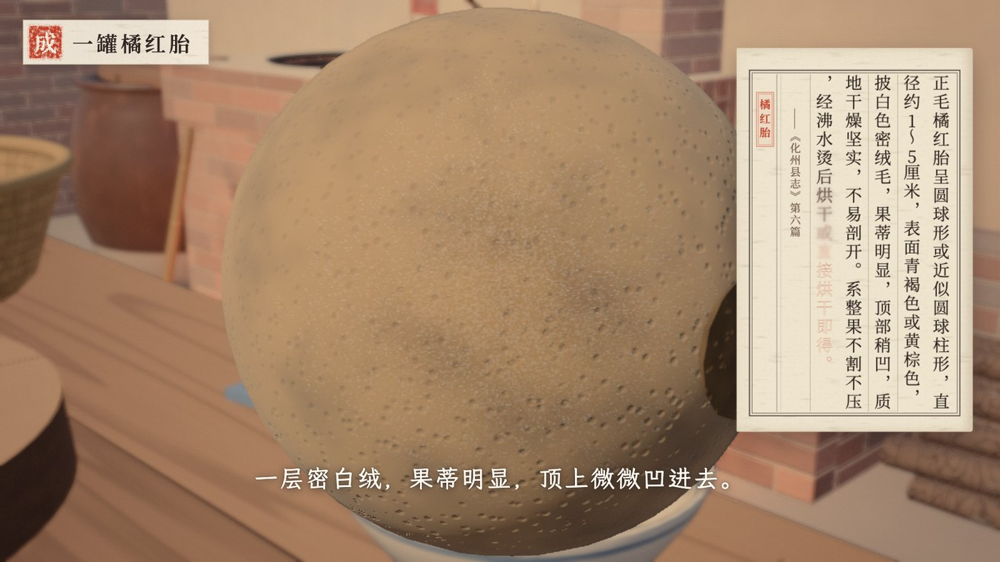
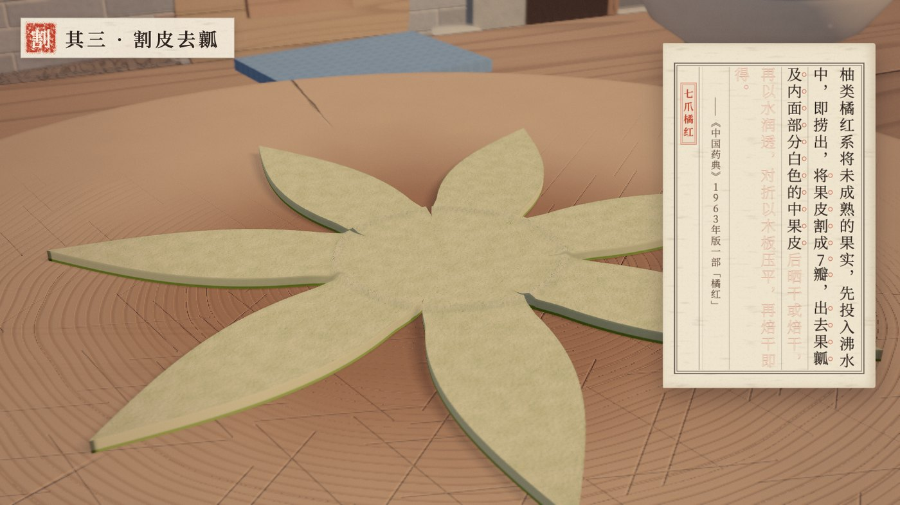
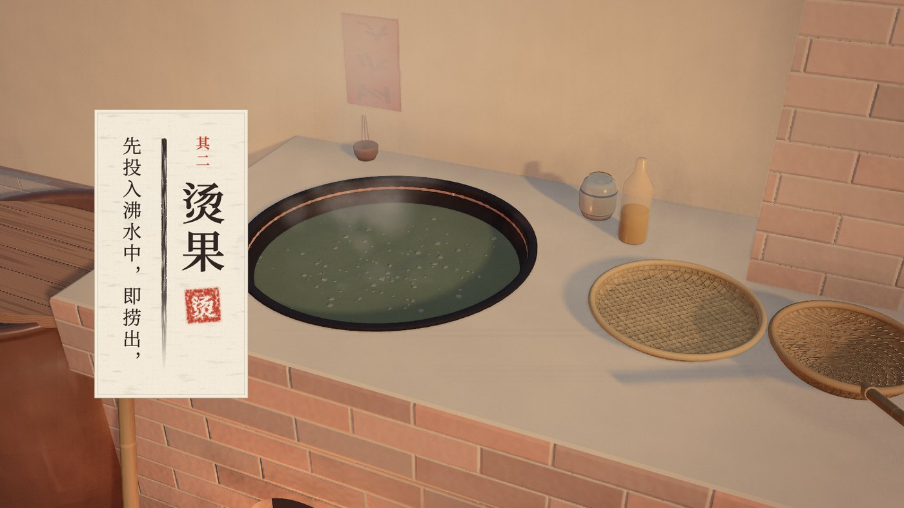

# 化橘红 · 古法加工

**四种传统做法的三维演示**　·　七爪、大五爪、压果片、橘红胎

> 柚类橘红系将未成熟的果实，先投入沸水中，即捞出，将果皮割成五至七瓣，出去果瓤及内面部分白色的中果皮后晒干或焙干，再以水润透，对折以木板压平，再焙干即得。
>
> ——《中国药典》1963 年版一部「橘红」条

五六月，化州的湿热起来了。柚子还只有拳头大，皮上覆着一层灰白的细绒，摸上去是哑的——这就是橘红。不是橘子，也不是橘子皮，是化州柚未成熟的幼果外面那层果皮。

出了这片地就不行。宝山的礞石土壤、罗江鉴江的小气候，换个地方种，绒毛就稀，柚皮苷就掉。旧志里写「惟署内城内者宜用」。

这句药典的工艺，写下来是六个动作：烫、割、去瓤、晒或焙、润透对折压平、再焙干。写进书里是六十多年前的事，但在化州乡下，它只是阿婆手上的一套动作，一代代传下来，没有图纸，也没有文字。

一百斤鲜果，最后只出四五斤干皮。



<sub>入口是四幅挂轴。在哪一幅上停一停，它就往下垂一截，露出成品的白描、书上的头一句，和一串工序的小印；点一下，那一幅的纸铺满整屏，揭开就是院子。</sub>

---

## 同一颗果子，四种去处

摘下来的果要先过一杆秤。不到 150 克的做胎，超过 230 克的才够格割瓣——分工从这里开始，各自走完剩下的路。

<table>
<tr>
<td width="50%"><br><sub><b>七爪</b>　割七瓣、刮掉白瓤、晒、润透、对折压平、复焙。贡品制式。十片一扎，红头绳从根部的结出发，顺着每一瓣拉出去。</sub></td>
<td width="50%"><br><sub><b>大五爪</b>　同样的路，只割五刀。润透后先把瓣尖折回三毫米，再整片对折，成截角五瓣花。民间多用这种做法。</sub></td>
</tr>
<tr>
<td><br><sub><b>压果片</b>　不割瓣。整颗压扁，压一夜、翻面、烘干、再压，最后用切药刀切成薄片。切面上看得见外皮一圈、白瓤、压实的果肉。这是市面上最多的形态。</sub></td>
<td><br><sub><b>橘红胎</b>　疏下来的小果，不割不压。一半烫过、一半直接烘，整颗烘干，绒毛还在。柚皮苷含量最高。</sub></td>
</tr>
</table>

四条线共用同一个院子、同一个灶、同一口锅。前段的摘果、称果、烫果是同一份代码，只换参数；分叉从下锅之后开始。

---

## 一句古法，一章一章写上去

<table>
<tr>
<td width="50%"><br><sub><b>书页</b>　做到哪一步，就描到哪一句；刚写上的那句，旁边圈一串朱圈。</sub></td>
<td width="50%"><br><sub><b>题签</b>　每章开头挂出一张：其一、其二……章名落墨，一笔飞白，盖印。</sub></td>
</tr>
</table>

片子的右边，时常翻开一页线装书。书上那句古法，起先只是一行淡淡的朱红空心字，像描红本上等人来描的底样。院子里每做完一章，那一章的句子就落了墨——一个字一个字洇开、收干。等十片扎好、一罐装满，整句也就描满了，页脚盖一方「成」。

药典里的一句话，原是这样一步一步做出来的。

---

## 这是怎么做的

不是拍视频，也不是做模型——**全部由程序生成**。

院子里每一片瓦、灶膛里的每一块炭、果子表皮上的每一根绒毛，都是算出来的，没有导入任何外部 3D 模型。声音也几乎全是算的：落水、笊篱沥水、下刀、刮瓤、压板、打结、切药，还有锅里的水、灶火的噼啪、炭火的嘶声，全部由 Web Audio 实时合成。只有两段底色用了真实录音——院子里远处的鸟、灶膛里的火——都是 CC0，随仓库一起分发，出处与处理参数见 [`public/audio/CREDITS.md`](public/audio/CREDITS.md)。

纸也是算的。书页的竹纸纹、印泥的毛边、白描的笔触、题签上那一笔飞白，都出自噪声滤镜和几行公式，不用一张图片素材。

- **Three.js + TypeScript**，Vite 构建
- **按段拆导演**：十三个独立小动画（`src/acts/`），每条线只写「用哪几段 + 参数 + 自己的台本」（`src/lines/`）
- **界面跟着时间走**：题签、书页、落墨、圈点都是时间的函数，拖进度、倒回去看，字也跟着退回去
- **换线不换网页**：纸盖着的时候把院子拆了重搭，地址栏照样变，浏览器的前进后退都认
- **按 1920×1080 排版**，整体缩放；断网可跑

---

## 怎么跑

```bash
npm install
npm run dev
```

浏览器打开 http://127.0.0.1:5180/

线上版：https://angelcomilk.github.io/huajuhong-craft-3d/

| 地址 | 看什么 | 时长 |
|---|---|---|
| `/` | 入口页：四幅竖轴，悬停看各自的工序和成品，点了在同一页里转进去 | — |
| `/?line=qizhua` | 七爪 | 约 3 分 45 秒 |
| `/?line=wuzhua` | 大五爪 | 约 3 分 45 秒 |
| `/?line=yaguo` | 压果片 | 约 3 分 20 秒 |
| `/?line=tai` | 橘红胎 | 约 2 分钟 |

加 `&t=秒&pause` 跳到某一刻停住，比如 `/?line=wuzhua&t=135&pause`。声音开关快捷键 <kbd>M</kbd>。

```bash
npm run build     # 类型检查 + 声音时刻检查 + 打包
npm run check:audio  # 只跑声音时刻检查（改了段落时长或音效触发时间后）
npm run fonts     # 字体子集化（改过文案后要重跑）
```

---

## 目录

```
src/
  main.ts        入口，按 ?line 选一条线
  director.ts    导演：把各段按顺序串起来
  stage.ts       这一幕的舞台状态
  camera.ts      镜头
  acts/          十三个独立小段：摘果、称果、烫果、割、晒、折、压、焙、捆、
                 压果、切片、连烘、结尾
  lines/         四条线，各带台本与参数
  world/         院子世界：灶、铁锅、案台、竹匾、焙炉、柚子树、水缸、
                 杆秤、压石、切药刀、簸箕、玻璃罐…
  gfx/           渲染基础：程序化几何、着色器、后期、环境光
  audio/         实时合成的声音
  ui/            入口页（四条屏、成品白描）、封面、章节题签、字幕、书页、结尾、控制条
public/fonts/    思源宋体、霞鹜文楷（已子集化）
scripts/         字体子集化、逐帧截图
shots/           README 里的几张图
```

---

## 几句说明

工艺依据《中国药典》1963 年版与 2006 年国家地理标志产品公告；形态与参数核对过地方志、行业资料与专利文献。凡资料里没有的——比如古法到底压多久、去瓤用的究竟是什么铲——代码里按功能推演，不假装是考据。

画面里的老屋、灶、竹匾、焙炉，参照的是化州一带农家院子的样子。屋檐下那杆秤，原本就挂在灶间的墙上。

本作品用于工艺与文化展示，非官方网站。工艺描述整理自公开资料，不构成任何用药建议。
